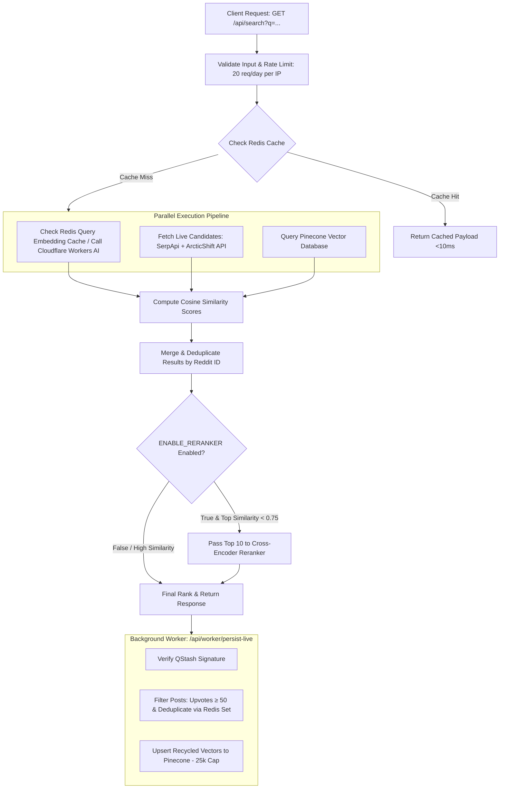

# Redex: Semantic Reddit Search Engine

High-performance, self-indexing semantic search engine for Reddit built on Next.js 16, Pinecone, Cloudflare Workers AI embeddings, and Upstash Redis/QStash.

---

## 1. What is the Problem & How It Solves It

### The Real Problem
* **Broken Native Reddit Search**: Reddit's search engine relies on strict keyword matching — searching *"best ANC headphones for coding"* misses top threads titled *"what headsets do you use in open offices?"* due to zero keyword overlap.
* **The "site:reddit.com" Workaround**: Developers manually append `site:reddit.com` to Google because Reddit's search is unusable, but Google results lack semantic understanding, upvote filters, and structured metadata.
* **The $10,000/Month Pre-Indexing Trap**: Reddit generates ~500M posts annually. Vectorizing and storing all of Reddit upfront requires massive database infrastructure ($10k+/month in vector DB costs).

### The Real Solution
* **Zero-Touch Self-Indexing Engine**: Redex starts with zero pre-indexed data; it performs live web discovery (SerpApi + ArcticShift) on user searches and automatically indexes discovered quality threads into Pinecone in the background.
* **Semantic Vector Intent Matching**: Vectorizes queries into 768-dimensional embedding space (`BAAI/bge-base-en-v1.5`), finding relevant discussions based on actual meaning and technical context rather than exact words.
* **Recycled Embedding Persistence**: Embeddings generated during live search are passed inside async QStash background payloads, persisting vectors to Pinecone with **zero additional AI token overhead**.

---

## 2. Flow of Execution

---

## 3. Important Architectural Tradeoffs

* **On-Demand Web Discovery vs. Pre-Indexed Vector DB**
  * *Tradeoff*: Accepts ~1-2s cold-search latency for un-indexed topics to eliminate millions in ingestion costs, achieving zero-cost infinite Reddit coverage.
* **Embedding Payload Recycling vs. Worker Re-Vectorization**
  * *Tradeoff*: Ships computed vector arrays (~3KB) directly inside QStash background payloads to eliminate redundant AI API calls during DB persistence.
* **Bi-Encoder Cosine Retrieval vs. Heavy Cross-Encoder Reranking**
  * *Tradeoff*: Uses single-pass vector similarity by default to guarantee sub-500ms queries, bypassing expensive cross-encoder reranking unless similarity falls below 0.75.

---

## 4. How Would You Scale It

* **Dedicated Text Embeddings Inference (TEI) Cluster**
  * Replace external API bottlenecks with a self-hosted HuggingFace TEI container on GPU (Modal / RunPod), dropping vector generation latency from ~300ms to <15ms.
* **Subreddit-Clustered Vector Sharding**
  * Partition Pinecone indexes into domain-specific vector namespaces (`tech`, `finance`, `gaming`) to maintain flat ANN search latency as vector count scales past 10M+.
* **Real-Time Pushshift Firehose Ingestion**
  * Transition from pull-based web discovery (SerpApi) to continuous Pushshift / Reddit WebSocket firehose streaming for real-time background vectorization of top subreddits.

---

## Quick Reference

### Tech Stack
* **Framework**: Next.js 16 (App Router)
* **Vector Database**: Pinecone Serverless
* **AI Embeddings**: Cloudflare Workers AI (`@cf/baai/bge-base-en-v1.5` - 768 dims) — Hugging Face fallback
* **Live Search**: SerpApi (`site:reddit.com`) + ArcticShift API
* **Caching & Queues**: Upstash Redis + Upstash QStash

### Local Development Setup
1. `git clone https://github.com/yourusername/redex.git && cd redex`
2. `npm install`
3. Configure `.env` with `PINECONE_API_KEY`, `PINECONE_INDEX`, `SERPAPI_API_KEY`, `CLOUDFLARE_ACCOUNT_ID`, `CLOUDFLARE_API_TOKEN`, `UPSTASH_REDIS_REST_URL`, `UPSTASH_REDIS_REST_TOKEN`, `QSTASH_TOKEN`, `APP_URL`.
4. `npm run dev`
