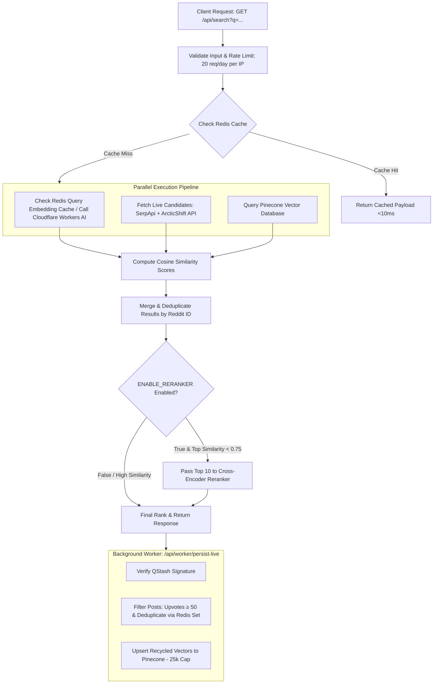

# Redex: Semantic Reddit Search Engine

High-performance, self-indexing semantic search engine for Reddit built on Next.js 16, Pinecone, Cloudflare Workers AI embeddings, and Upstash Redis/QStash.

---

## 1. What is the Problem & How It Solves It

### The Real Problem
* **Broken Native Reddit Search**: Reddit's search engine relies on strict keyword matching — searching *"best ANC headphones for coding"* misses top threads titled *"what headsets do you use in open offices?"* due to zero keyword overlap.
* **The "site:reddit.com" Workaround**: Developers manually append `site:reddit.com` to Google because Reddit's search is unusable, but Google results lack semantic understanding, upvote filters, and structured metadata.
* **The $10,000/Month Pre-Indexing Trap**: Reddit generates ~500M posts annually. Vectorizing and storing all of Reddit upfront requires massive database infrastructure ($10k+/month in vector DB costs).

### The Real Solution
* **Zero-Touch Self-Indexing Engine**: Redex starts with zero pre-indexed data; it performs live web discovery (SerpApi + ArcticShift) on user searches and automatically indexes discovered quality threads into Pinecone in the background.
* **Semantic Vector Intent Matching**: Vectorizes queries into 768-dimensional embedding space (`BAAI/bge-base-en-v1.5`), finding relevant discussions based on actual meaning and technical context rather than exact words.
* **Recycled Embedding Persistence**: Embeddings generated during live search are passed inside async QStash background payloads, persisting vectors to Pinecone with **zero additional AI token overhead**.

---

## 2. Flow of Execution

---

## 3. Important Architectural Tradeoffs

* **On-Demand Web Discovery vs. Pre-Indexed Vector DB**
  * *Tradeoff*: Accepts ~1-2s cold-search latency for un-indexed topics to eliminate millions in ingestion costs, achieving zero-cost infinite Reddit coverage.
* **Embedding Payload Recycling vs. Worker Re-Vectorization**
  * *Tradeoff*: Ships computed vector arrays (~3KB) directly inside QStash background payloads to eliminate redundant AI API calls during DB persistence.
* **Bi-Encoder Cosine Retrieval vs. Heavy Cross-Encoder Reranking**
  * *Tradeoff*: Uses single-pass vector similarity by default to guarantee sub-500ms queries, bypassing expensive cross-encoder reranking unless similarity falls below 0.75.

---

## 4. How Would You Scale It

* **Dedicated Text Embeddings Inference (TEI) Cluster**
  * Replace external API bottlenecks with a self-hosted HuggingFace TEI container on GPU (Modal / RunPod), dropping vector generation latency from ~300ms to <15ms.
* **Subreddit-Clustered Vector Sharding**
  * Partition Pinecone indexes into domain-specific vector namespaces (`tech`, `finance`, `gaming`) to maintain flat ANN search latency as vector count scales past 10M+.
* **Real-Time Pushshift Firehose Ingestion**
  * Transition from pull-based web discovery (SerpApi) to continuous Pushshift / Reddit WebSocket firehose streaming for real-time background vectorization of top subreddits.

---

## 5. Key Engineering Decisions — What & Why
*Written in ASD-STE100 Simplified Technical English.*

### 5.1 Semantic Search with 768-Dimensional Intent Vectors

> *Built a semantic search engine using Cloudflare Workers AI and Pinecone, matching 768-dimensional intent vectors to retrieve highly contextual Reddit discussions.*

**WHAT:**

The system converts each user query into a 768-dimensional number array (vector). It uses the `BAAI/bge-base-en-v1.5` AI model on Cloudflare Workers AI. A Hugging Face API is the fallback if Cloudflare is not available.

The system also converts each Reddit post into a vector with the same model. It stores these post vectors in the Pinecone vector database. When a user makes a search, the system calculates the cosine similarity between the query vector and all stored post vectors. It returns the posts with the highest similarity scores. The result does not depend on shared keywords between the query and the post.

**WHY:**

Reddit search uses keyword matching only. If a user searches "best ANC headphones for coding", Reddit does not show a thread with the title "what headsets do you use in open offices?". These two texts share zero keywords, but they have the same meaning.

Vector embeddings solve this problem. The AI model puts texts with similar meaning near each other in 768-dimensional space. The system measures the distance between the query vector and each post vector. Posts with a small distance (high cosine similarity) are relevant results. This finds discussions by intent, not by exact words.

**Source files:** [`embeddings.js`](src/lib/embeddings.js) · [`pinecone.js`](src/lib/pinecone.js) · [`search.js`](src/lib/search.js)

---

### 5.2 Zero-Touch Self-Indexing Web Discovery Pipeline

> *Designed a zero-touch web discovery pipeline (SerpApi) that bypasses bulk pre-indexing by automatically self-indexing live user queries on demand.*

**WHAT:**

The Pinecone database starts empty. The system does not pre-index Reddit data.

When a user searches, the system sends a `site:reddit.com` query to SerpApi (Google). At the same time, it sends a query to the ArcticShift API. Both calls run in parallel. The system collects the Reddit threads that these APIs return.

The system then generates embedding vectors for these threads during the same request. It scores each thread against the query vector. After it sends the results to the user, it triggers a QStash background worker. This worker saves posts with 50 or more upvotes into Pinecone. The next user who searches a related topic gets instant results from the database.

**WHY:**

Reddit creates approximately 500 million posts each year. If you pre-index all posts, you need continuous ingestion pipelines, hundreds of millions of AI API calls, and vector storage that costs more than \$10,000 per month.

The zero-touch approach removes this cost. The database grows only from real user searches. The system indexes only threads that people actually search for. This keeps storage costs at zero (Pinecone free tier, 25,000-vector cap). The system still gives full Reddit coverage for any topic.

**Source files:** [`googleSearch.js`](src/lib/googleSearch.js) · [`arcticShift.js`](src/lib/arcticShift.js) · [`route.js`](src/app/api/search/route.js) · [`persist-live/route.js`](src/app/api/worker/persist-live/route.js)

---

### 5.3 Sub-10 ms Repeat Latency and Zero-Cost Vector Persistence

> *Reduced repeat query latency to < 10 ms via Upstash Redis, and optimized writes using QStash background workers for zero-cost vector persistence.*

**WHAT:**

The system caches every search response in Upstash Redis. The cache TTL (time to live) changes with the date filter:
- Weekly queries: 30-minute TTL.
- Monthly queries: 2-hour TTL.
- All-time queries: 24-hour TTL.

When a user sends the same query again, the system returns the cached response. This takes less than 10 ms. No downstream API calls occur.

For database writes, the system recycles embedding vectors. During the search request, the system already computes vectors for live posts. It passes these vectors (approximately 3 KB each) inside the QStash background payload. The persist-live worker receives these vectors and upserts them directly into Pinecone. The worker does not call the AI model again.

**WHY:**

Without a cache, every search triggers three API calls:
- Cloudflare Workers AI embedding: approximately 300 ms.
- SerpApi web search: approximately 800 ms.
- Pinecone vector query: approximately 200 ms.

The total is 1 to 2 seconds per request. Redis caching reduces repeat queries to under 10 ms.

Without vector recycling, the background worker must re-embed every post. This uses AI tokens a second time for the same data. The system avoids this cost. It computes each embedding exactly once during the search request. It then passes the computed vector to the background worker. This gives zero additional AI token overhead for database persistence.

**Source files:** [`cache.js`](src/lib/cache.js) · [`route.js`](src/app/api/search/route.js) · [`persist-live/route.js`](src/app/api/worker/persist-live/route.js)

---

### 5.4 Parallel Execution Pipeline with Multi-Source Deduplication

> *Orchestrated a parallel execution pipeline to concurrently query Pinecone and live web APIs, implementing result deduplication by ID to merge multi-source candidates before final ranking.*

**WHAT:**

On a cache miss, the search handler starts three operations at the same time with `Promise.all`:
1. Generate the query embedding vector (or read it from the Redis cache).
2. Fetch live Reddit threads from SerpApi and ArcticShift.
3. Query the Pinecone vector database for stored matches.

When all three operations complete, the system merges live results and database results into one list. It uses a `Map` with the Reddit post ID as the key. If the same post appears in both sources, the system keeps the higher similarity score. It then filters the merged list with a dynamic threshold:
- Posts with 100 or more upvotes: minimum similarity of 0.20.
- All other posts: minimum similarity of 0.25.

The system ranks the final list by relevance or by date.

**WHY:**

If the three operations run one after another, their latencies add up: 300 ms + 800 ms + 200 ms = 1,300 ms. Parallel execution overlaps them. The total time equals the slowest single operation (approximately 800 ms). This saves 500 ms or more per request.

Deduplication is necessary because the same popular Reddit thread often appears in both Google results and the Pinecone database. Without ID-based merging, the user sees duplicate entries. The system merges on the Reddit post ID and keeps the best score. This produces a clean result set. It combines the freshness of live web discovery with the precision of stored vector search.

**Source files:** [`route.js`](src/app/api/search/route.js) · [`search.js`](src/lib/search.js)

---

## Quick Reference

### Tech Stack
* **Framework**: Next.js 16 (App Router)
* **Vector Database**: Pinecone Serverless
* **AI Embeddings**: Cloudflare Workers AI (`@cf/baai/bge-base-en-v1.5` - 768 dims) — Hugging Face fallback
* **Live Search**: SerpApi (`site:reddit.com`) + ArcticShift API
* **Caching & Queues**: Upstash Redis + Upstash QStash

### Local Development Setup
1. `git clone https://github.com/yourusername/redex.git && cd redex`
2. `npm install`
3. Configure `.env` with `PINECONE_API_KEY`, `PINECONE_INDEX`, `SERPAPI_API_KEY`, `CLOUDFLARE_ACCOUNT_ID`, `CLOUDFLARE_API_TOKEN`, `UPSTASH_REDIS_REST_URL`, `UPSTASH_REDIS_REST_TOKEN`, `QSTASH_TOKEN`, `APP_URL`.
4. `npm run dev`
